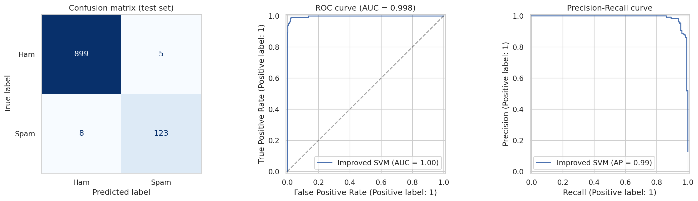

# SMS Spam Classification with SVM

Classifies text messages as **spam** or **ham** (normal message) using TF-IDF features and a Support Vector Machine (SVM).

> Replace `YOUR_USERNAME` and `YOUR_REPO` below with your own GitHub details, then the button works.

[](https://colab.research.google.com/github/YOUR_USERNAME/YOUR_REPO/blob/main/SMS_Spam_SVM_Improved.ipynb)

## Dataset
[SMS Spam Collection](https://www.kaggle.com/datasets/uciml/sms-spam-collection-dataset): about 5,500 labelled English SMS messages (about 13% spam). After removing exact duplicates, about 5,170 messages remain.

## What is in this repository
| File / folder | Purpose |
|---|---|
| `SMS_Spam_SVM_Improved.ipynb` | The full notebook (code + explanations + saved results) |
| `requirements.txt` | Python packages needed |
| `figures/` | Charts saved by the notebook |
| `data/` | Optional place for the Kaggle `spam.csv` (otherwise downloaded automatically) |

## How to run
**Google Colab (easiest):** click the badge above, then *Runtime > Run all*.

**On your computer:**
```bash
git clone https://github.com/YOUR_USERNAME/YOUR_REPO.git
cd YOUR_REPO
pip install -r requirements.txt
jupyter notebook SMS_Spam_SVM_Improved.ipynb
```

## Method in short
1. Remove duplicate messages, then split 80% train / 20% test (the test set is used once, at the end).
2. Clean the text. Links, numbers and money signs are kept as special words, because they are strong spam clues.
3. Convert text to numbers with TF-IDF (single words and word pairs).
4. Compare 5 models with 5-fold cross-validation, then tune the Linear SVM with grid search (score: F1 of the spam class).
5. Evaluate once on the test set, and study the mistakes and the most important words.

## Results (test set: 1,035 messages, 131 of them spam)
| Metric | Starter notebook model | Improved model |
|---|---|---|
| Accuracy | 0.9836 | 0.9874 |
| Precision (spam) | 0.9672 | 0.9609 |
| Recall (spam) | 0.9008 | 0.9389 |
| F1 (spam) | 0.9328 | 0.9498 |
| Spam missed | 13 | 8 |
| Real messages blocked | 4 | 5 |

ROC AUC of the improved model: 0.998.



**Honest note:** the test set is small, so one extra mistake moves the scores by about 0.5-1 percentage point. The improvement mainly comes from catching more spam (higher recall) while blocking about the same number of real messages. It should be read as a small, consistent gain, not a big jump.

## Limitations
- English-only messages from one older collection; modern spam looks different.
- Single train/test split (no nested cross-validation).

## Improvements over the starter notebook
Works outside Colab, duplicates removed first, numbers/links kept as signals, F1 instead of accuracy only, no test-set reuse, 5 models compared, extra evaluation charts and error analysis, fixed random seed and `requirements.txt`.
